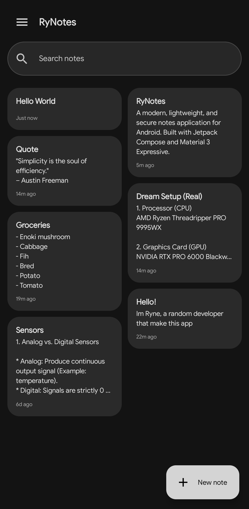
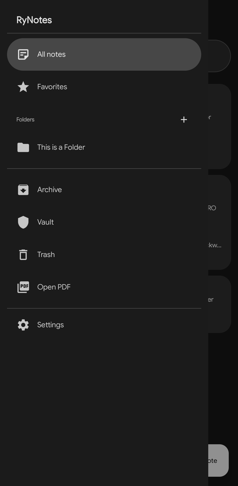
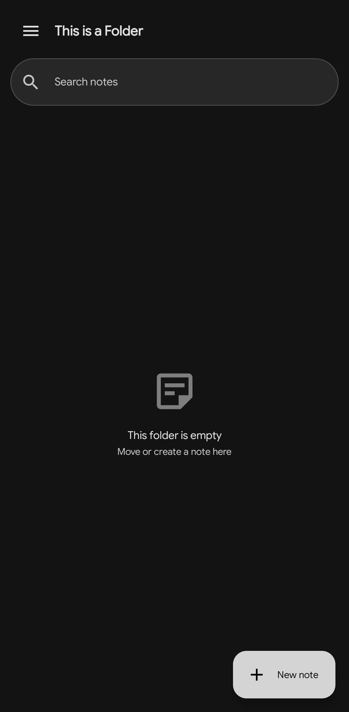
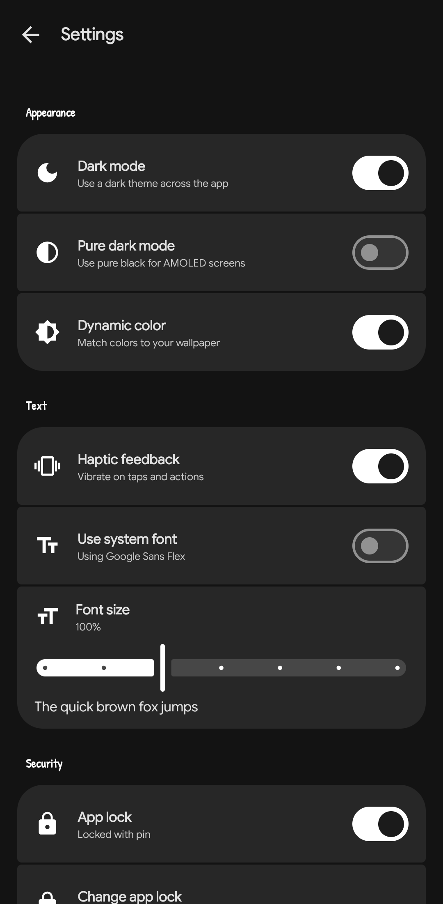
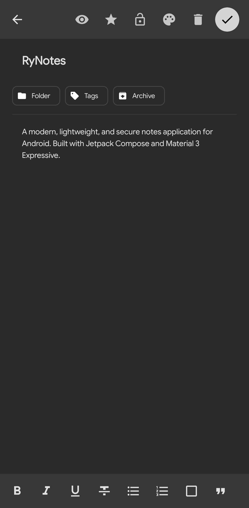
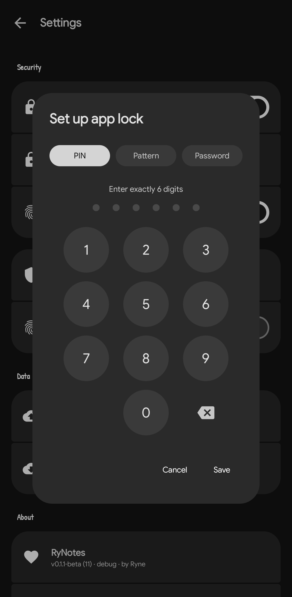

<div align="center">

<h1>RyNotes</h1>
<p>A private notes app for Android, built with Jetpack Compose and Material 3 Expressive.</p>
<p>Organize notes with folders, tags, and a vault, all stored on your device.</p>
</div>
<p align="center">
  <a href="https://github.com/rynekryz/rynotes/stargazers"></a>
  <a href="https://github.com/rynekryz/rynotes/tags"></a>
  <a href="LICENSE"></a>
  
  
</p>

<p align="center">
  <a href="https://github.com/rynekryz/rynotes/releases"></a>
</p>

---

## Screenshots

<div align="center">






</div>

---

## Features

- Material 3 Expressive, with dynamic color from your wallpaper (Android 12+)
- Dark mode and a pure black OLED mode
- Six curated note colors, so things feel like yours
- App lock with PIN, pattern, password, or biometrics
- A Vault with its own secret for the sensitive stuff (your diary is safe here)
- Folders, tags, pin, favorite, and archive
- Trash that holds deleted notes for 30 days, in case you change your mind (you will)
- Real-time search across titles and content
- Light Markdown (bold, italic, underline, bullets)
- Built-in PDF viewer
- Backup and restore as a ZIP/JSON file
- etc.

---

## Technical Stack

- **UI:** Jetpack Compose with Material 3 Expressive
- **Architecture:** MVVM
- **Persistence:** DataStore Preferences
- **Security:** BiometricPrompt with an AES vault
- **Language:** Kotlin
- **Build:** Gradle (Kotlin DSL)

---

## Building

You'll need Android Studio (latest stable), JDK 21, and SDK 37. Minimum is Android 12 (API 31).

1. Clone the repo and open it in Android Studio.
2. Sync Gradle and run the `:app` module.

```bash
./gradlew assembleDebug
```

`arm64` fits most phones, `armv7` is for older 32-bit ones, `x86_64` is for emulators, and `universal` works anywhere if you're not sure.

---

## Project Structure

```
RyNotes/
└── app/src/main/java/com/rynekryz/rynotes/
    ├── MainActivity.kt
    ├── HomeScreen.kt
    ├── NoteEditorScreen.kt
    ├── VaultScreen.kt
    ├── SettingsScreen.kt
    ├── NoteViewModel.kt
    ├── Note.kt
    └── ...
```

---

## License

Licensed under GPL-3.0. See [LICENSE](LICENSE).

<div align="center">
<strong>Made with ♥︎ by Ryne</strong>
</div>
<div align="center">
  <a href="https://discord.gg/YKhWXXhKmC"></a>
  <a href="https://tiktok.com/@rynekryz"></a>
</div>
